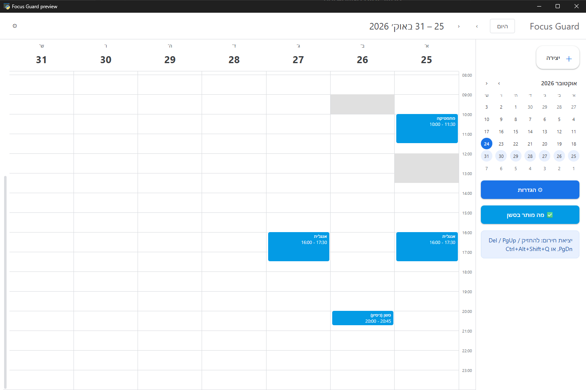
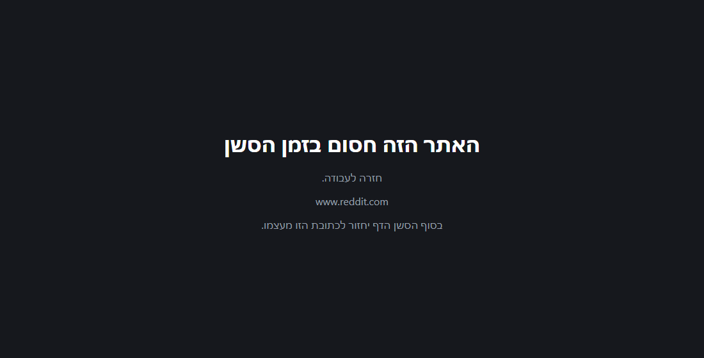

# Workmode

**A Windows 11 focus tool that plans work sessions in a calendar and, while one runs, keeps only the apps and sites you
chose in front.**



## What it does

- **Plan sessions like in Google Calendar.** A right-to-left week view (Hebrew UI): click or drag to create a
  session, repeat it weekly, drag to move or resize, "this event / all events" for a series.
- **A gentle start.** A 5-second song a minute before a planned session and a small window with "Start now" or
  "Not today". Missed starts (PC asleep), restarts and back-to-back sessions are handled.
- **Enforcement during a session.** Programs that are not on the allow-list are minimized and wait until the end;
  nothing is ever closed, and they can be muted with one click. A Chrome extension sends sites that are not allowed
  to a blocked page and returns the tab to its address when the session ends. YouTube can be limited to chosen
  channels, playlists or single videos.
- **Friction, not walls.** Closing an allowed window brings it back with a short roast (optionally written by
  Gemini); leaving early takes holding a key and typing your own emergency phrase.
- **Safe by design.** A grace period at the start, a trial mode that only logs, recovery after a crash or reboot
  (every waiting window comes back), and no statistics or streaks.



## Tech stack

- **Python 3.12**, fully typed: pywin32 (windows, shortcuts, version info), psutil, pycaw (per-program audio),
  pystray (tray icon), Pillow (icon).
- **pywebview** for the desktop windows; plain HTML, CSS and JavaScript, with **FullCalendar 6** for the week view.
- **Chrome extension** (Manifest V3, ES modules) for site and YouTube rules.
- A small local **HTTP bridge** (`127.0.0.1` only, random token) between the extension and the enforcement process.
- Optional **Gemini API** for the roast lines (key from an environment variable).

## Install and run

Requires Windows 11, Python 3.12 and Google Chrome.

1. Clone the repository into a folder inside your user profile (for example `%USERPROFILE%\Workmode`).
2. Run `install.cmd`. It installs the Python packages, writes a local `config.json` and the extension's
   `config.js` with a fresh token, and creates the `Workmode` shortcut in the same folder.
3. In Chrome open `chrome://extensions`, turn on Developer mode, choose "Load unpacked" and pick the `extension`
   folder.
4. Edit `config.json`: set your own emergency phrase (and the apps you work in), then run
   `python -m focus_guard check` until it prints `Config OK`.
5. Open the app from the shortcut, adjust the allow-list from the window and plan a session.

Try it without enforcement first: `focus start 25` is a dry run that only logs what it would do, and
`python tools/preview_calendar.py` opens the calendar on sample data. The full guide is in
[docs/user-guide.md](docs/user-guide.md).

## Updating

Workmode updates only from signed GitHub Releases.

- When a new version is ready, the Workmode button in Chrome's toolbar shows an orange `!`. Open it and click
  "עדכון לגרסה העדכנית", or double-click `Update.cmd` in the install folder. Both run the same checks.
- Nothing installs on its own. An update never runs during a session or within 10 minutes of a planned one; after the
  session the button becomes active.
- The updater checks the release's signature and every file, backs up the files it replaces, starts the new version
  and rolls back if it does not come up. `config.json`, `extension/config.js`, `state/` and `media/` are never touched.
- In a git clone the updater refuses; update with `git pull`.
- Version 1.2.2 and older have no updater yet: update them once by hand.

Maintainer: run `python tools/release.py --new-key` once (the private key stays offline in
`%USERPROFILE%\.workmode\`), then `python tools/release.py 1.3.0` for each release. If the signing key is ever lost
or leaked, no more signed releases are published, a notice goes here, and users reinstall from a fresh clone that
carries a new public key.

## Tests and quality

- **722 Python tests** (`python -m unittest discover -s tests -t .`) and **79 JavaScript tests** for the extension
  and the calendar logic (`node --test extension/*.test.mjs "tests/js/*.test.mjs"`).
- `ruff check`, `ruff format --check` and `mypy` on `focus_guard` and `tools` all pass;
  every function is typed.
- Logic is pure and tested apart from Win32: the guard talks to the system only through the protocols in
  `focus_guard/ports.py`, and tests use fakes.
- Every stage was planned in a written design (`docs/superpowers/specs/`), built test-first and reviewed, including a
  security review of the bridge, the extension, the installer and every web page before this release.

## Architecture

```
                 +------------------------------+
  tray, window   |  app (background process)    |   calendar, settings, allow-list (pywebview + JS)
  ------------>  |  scheduler -> cue, start     |
                 +--------------+---------------+
                                | starts
                 +--------------v---------------+        +-----------------------------+
                 |  guard (enforcement loop)    | <----> |  guardian                   |
                 |  watcher -> wait / mute /    |restart |  restarts the guard while a |
                 |  restore, roasts, emergency  |        |  session is active          |
                 +--------------+---------------+        +-----------------------------+
                                | HTTP bridge 127.0.0.1 + token
                 +--------------v---------------+
                 |  Chrome extension (MV3)      |   sites, YouTube channels / playlists / videos
                 +------------------------------+
```

- `focus_guard/app.py` is the single background process (one instance, tray icon, starts with Windows). Its
  scheduling loop (`background.py`, `scheduler.py`) is pure: time and events in, actions out.
- `guard.py` runs the enforcement loop; `watcher.py` turns window snapshots into events without Windows calls, and
  `waiting.py` / `muting.py` keep what must be restored in `state/` so a crash or reboot loses nothing.
- `server.py` is the bridge the extension polls; `extension/background.js` applies the rules to every tab.
- Settings live in `config.json` (gitignored); runtime state in `state/` (gitignored), written atomically.

## License

MIT, see [LICENSE](LICENSE). Bundled assets: [assets/LICENSES.md](assets/LICENSES.md) and
[assets/songs/LICENSES.md](assets/songs/LICENSES.md); FullCalendar is MIT
([its license](focus_guard/web/vendor/fullcalendar/LICENSE.md)).
